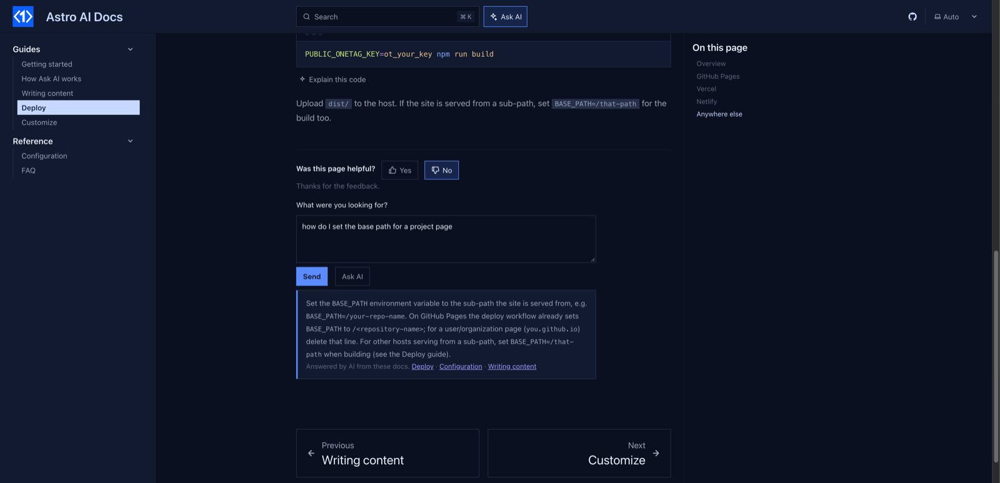

# starlight-page-feedback

**"Was this page helpful?"** at the end of every [Starlight](https://starlight.astro.build) page. Free, no account, no backend, no extra service to sign up for.



- **Works with the analytics you already run.** Votes are sent as an event to Plausible, Umami, Google Analytics, PostHog, Fathom or Simple Analytics, whichever the site loads. Nothing to configure.
- **A "No" can become a GitHub issue.** If your Starlight config has `editLink`, the repository is picked up from it and readers get a prefilled "Docs feedback" issue link with the page URL and their comment.
- **Or post to your own endpoint**: any URL that accepts JSON (a form service, a Cloudflare Worker, a Google Apps Script).
- Remembers the reader's vote per page. Translated into English, 简体中文, 日本語, Español, Français, Deutsch, Português and 한국어, following the page language.
- **Optional AI switch**: with `ai: true`, a reader who clicks "No" can ask what they were looking for and get an answer from your docs, with links.

## Install

```bash
npm install starlight-page-feedback
```

```js
// astro.config.mjs
import { defineConfig } from "astro/config";
import starlight from "@astrojs/starlight";
import starlightPageFeedback from "starlight-page-feedback";

export default defineConfig({
  integrations: [
    starlight({
      title: "My docs",
      editLink: { baseUrl: "https://github.com/you/your-docs/edit/main/" }, // optional: enables the GitHub issue link
      plugins: [starlightPageFeedback()],
    }),
  ],
});
```

That is all. Votes show up in your analytics as the `Docs Feedback` event (Google Analytics: `docs_feedback`), with `page` and `helpful` properties, and `comment` when the reader wrote one.

## Options

| Option | Default | What it does |
| --- | --- | --- |
| `github` | from `editLink` | `"owner/repo"` for the prefilled issue link. `false` to turn it off. |
| `endpoint` | `""` | URL that receives `POST` JSON: `{ page, title, lang, helpful, comment }`. |
| `analytics` | `true` | Send the vote to the analytics already on the page. |
| `event` | `"Docs Feedback"` | Event name in your analytics. |
| `labels` | built-in | Override any text, e.g. `{ question: "Did this help?" }`. Keys: `question`, `yes`, `no`, `thanks`, `what`, `placeholder`, `send`, `sent`, `issue`, `ask`. |
| `exclude` | `[]` | Paths to skip, e.g. `["/", "/blog/*"]`. Splash pages are skipped already. |
| `ai` | `false` | `true` (or `{ key }`) to let readers who voted "No" ask AI. |

## The AI switch

```js
starlightPageFeedback({ ai: true })
```

When a reader says the page did not help, they can type what they were looking for and click **Ask AI**: the answer comes from your own pages (the Pagefind index Starlight already builds), with links to them. It runs in the browser through [OneTag AI](https://onetagai.com/?ref=starlight-page-feedback); on localhost it works right away on a shared demo key. A deployed site needs a free key, set as `PUBLIC_ONETAG_KEY` in `.env` or `ai: { key: "ot_..." }`: enter an email at onetagai.com and the key arrives in your inbox, no password, no card. The AI code loads only when a reader clicks the button.

With the switch off (the default) nothing AI-related is loaded.

## More for Starlight

- [starlight-reading-time](https://github.com/fengyiqicoder/starlight-reading-time): reading time, last updated and an outdated note under every page title.
- [starlight-share-highlight](https://github.com/fengyiqicoder/starlight-share-highlight): select text to copy a link that jumps to and highlights it.
- [starlight-glossary](https://github.com/fengyiqicoder/starlight-glossary): define a term once and readers get its definition in a tooltip wherever it appears, plus a glossary page.
- [starlight-onetag](https://github.com/fengyiqicoder/starlight-onetag): Ask AI, AI answers in search, page translation for readers, Explain this code, page summaries, ask about a selection.

## License

MIT.
